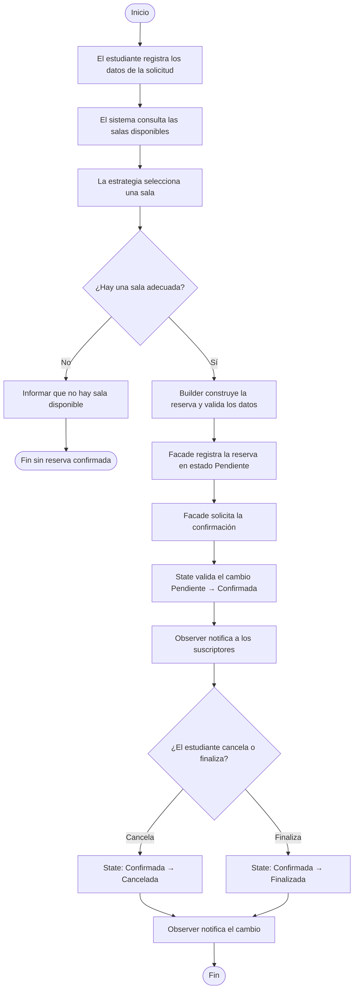

# Estación 1 — Comprender el problema y modelar el flujo

## Diagrama de flujo

## Responsabilidades que no deben quedar en Main

1. **Representar los datos del estudiante y de la sala** (`Estudiante`, `Sala`).
   Main no tiene por que saber como es por dentro un estudiante o una sala, eso le toca a cada clase. Si mañana a la sala le agregan algo nuevo, se cambia solo la sala y ya.
2. **Construir la reserva y validar sus datos** (`ReservaBuilder`).
   Si las validaciones quedan en Main toca repetirlas cada vez que se cree una reserva, y en algun momento a uno se le olvida una y se cuela una reserva mal hecha. Mejor que esten en un solo lado.
3. **Elegir la sala según un criterio** (`EstrategiaSeleccionSala`).
   Los criterios pueden cambiar o pueden salir nuevos (por capacidad, por preferida, por equipos...). Si eso esta en Main termina siendo un monton de if que nadie quiere tocar.
4. **Consultar las salas y guardar las reservas** (`RepositorioSalas`, `RepositorioReservas`).
   Hoy los datos estan en una lista, pero mañana pueden estar en una base de datos. Si Main sabe de donde salen los datos, toca cambiarlo todo cuando eso pase.
5. **Coordinar todo el proceso de reservar** (`ReservaFacade`).
   Main solo deberia decir "haga una reserva" y ya, no estar pendiente de que primero se consulta, luego se escoge, luego se construye y luego se guarda. Eso es mucho enredo para el.
6. **Avisar cuando la reserva cambia de estado** (`ObservadorReserva`).
   Si Main es el que avisa, cada vez que se agregue una forma nueva de notificar (correo, mensaje, log) toca meterle mano otra vez. Asi cada quien se suscribe y recibe el aviso solo.
7. **Controlar que cambios de estado se pueden hacer** (`EstadoReserva`).
   Si eso queda en Main hay que llenarlo de if para saber si se puede cancelar, confirmar o finalizar, y es facil que se pase un cambio que no deberia (tipo confirmar algo que ya se cancelo).

## Comprobación

Una clase `Main` que consulte salas, valide datos, construya reservas, notifique y
controle estados tendría muchas razones distintas para cambiar. Sus métodos no
estarían relacionados entre sí (baja cohesión), y cualquier ajuste —por ejemplo,
un nuevo criterio de selección o un nuevo estado— obligaría a modificar la misma
clase, con riesgo de romper las demás funciones. Además sería difícil de probar por
partes y de entender, convirtiéndose en una *clase Dios*.
